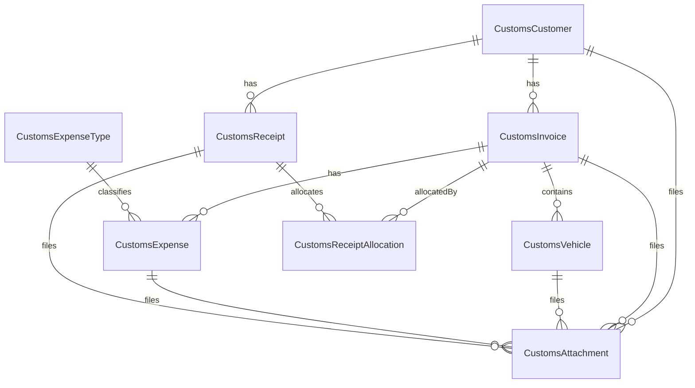

# تصميم Architecture — نظام التخليص الكمركي والنقل (المرحلة 2)

> **حالة المرحلة:** تصميم Domain Model فقط — لا كيانات C# ولا migrations ولا UI في هذه الوثيقة.  
> **المرجع السابق:** [`CUSTOMS_IMPLEMENTATION_PLAN.md`](CUSTOMS_IMPLEMENTATION_PLAN.md) (المرحلة 1)  
> **مراجع داعمة:** [`docs/CUSTOMS_CURRENCY_REUSE.md`](docs/CUSTOMS_CURRENCY_REUSE.md)، [`docs/CUSTOMS_RECEIPT_PAYMENT_PATTERNS.md`](docs/CUSTOMS_RECEIPT_PAYMENT_PATTERNS.md)  
> **تاريخ التصميم:** 2026-10-22

---

## 1. الهدف والنطاق وعزل الـ Module

### 1.1 الهدف

تصميم نظام **التخليص الكمركي والنقل** كـ Module منتج مستقل داخل منصة قيد، بنفس أنماط Gold / CarTrade، دون دمج جداوله في المحاسبة ودون كسر الأنظمة الحالية.

### 1.2 العزل (مثبّت من المرحلة 1)

| العنصر | القيمة |
|--------|--------|
| Enum | `ApplicationSystemType.CustomsClearance = 6` |
| Database | `AlMuhasibCustomsDb` |
| DbContext | `CustomsDbContext` + EF Migrations من اليوم الأول |
| Module | `CustomsClearanceSystemModule` + `CustomsMenuBuilder` + `CustomsPermissionRegistry` |
| Auth | `CustomsAuthService : IAuthService` داخل DB النظام فقط |

### 1.3 العلاقات الأساسية المطلوبة

```
Customer
  ├─→ Invoice
  │     ├─→ Vehicles / Shipments
  │     └─→ Expenses
  ├─→ Receipts ─→ Invoice(s)   (واحد أو عدة عبر Allocations)
  └─→ Account Statement        (تقرير محسوب، ليس جدولاً)
```

### 1.4 قرارات مثبتة

| قرار | الاختيار |
|------|----------|
| تسمية | بادئة `Customs*` + PascalCase (مثل `GoldCustomer`) — ليس snake_case |
| عملة | إعادة استخدام `AccountingCurrency` (`IQD` / `USD`) + helpers/rules المحاسبية |
| FX | جدول محلي `CustomsFxRate` — لا مشاركة `ExchangeRates` المحاسبية (`BranchScopedEntity`) |
| إجمالي الفاتورة | `TotalAmount = Sum(Vehicles.VehiclePrice) - DiscountAmount` |
| عملة السيارة | تُخزَّن ويُفرض `Vehicle.Currency == Invoice.Currency` عند الحفظ |
| نوع العميل | `Individual` / `Company` |
| أنواع المصاريف | كيان مرجعي `CustomsExpenseType` (مثل Gold) |
| مقبوضات متعددة | `CustomsReceipt` + `CustomsReceiptAllocation` |
| كشف حساب | تقرير مشتق |
| Enums في DB | `HasConversion<string>()` MaxLength ≈ 20؛ عرض عربي عبر `*Display.ToArabic` |
| مرفقات | `CustomsAttachment` بـ `OwnerType` + `OwnerId` |

---

## 2. ERD والكيانات والجداول



كل الكيانات ترث `BaseEntity` (`Id`, `SyncId`, `CreatedAt/By`, `UpdatedAt/By`, soft delete, `RowVersion`).

الجداول: `ToTable("Customs…")` بصيغة PascalCase plural إنجليزية.

### 2.1 `CustomsCustomer` → `CustomsCustomers`

| الحقل | النوع | ملاحظات |
|-------|-------|---------|
| `CustomerType` | `CustomsCustomerType` | `Individual` / `Company` |
| `Name` | string | الاسم الظاهر |
| `CompanyName` | string | يُستخدم عند `Company` (قد يكون فارغاً للفرد) |
| `Phone` | string | |
| `Address` | string | |
| `Notes` | string | |
| `IsActive` | bool | افتراضي `true` |
| `BalanceIqd` | decimal(18,2) | رصيد دينار — لا يُخلط مع الدولار |
| `BalanceUsd` | decimal(18,2) | رصيد دولار |

### 2.2 `CustomsInvoice` → `CustomsInvoices`

| الحقل | النوع | ملاحظات |
|-------|-------|---------|
| `CustomerId` | int FK | مطلوب |
| `InvoiceNumber` | string | ترقيم مثل `CI-0001` |
| `InvoiceDate` | DateTime | |
| `ServiceType` | `CustomsServiceType` | |
| `Currency` | `AccountingCurrency` | عملة المستند الواحدة |
| `FxRate` | decimal(18,4) | لقطة سعر الصرف عند الحفظ (USD→IQD) |
| `Description` | string | |
| `DiscountAmount` | decimal(18,2) | بنفس عملة الفاتورة |
| `TotalAmount` | decimal(18,2) | محسوب ويُحفظ |
| `PaidAmount` | decimal(18,2) | من التوزيعات |
| `RemainingAmount` | decimal(18,2) | `TotalAmount - PaidAmount` |
| `Status` | `CustomsInvoiceStatus` | |
| `InternalNotes` | string | داخلي |
| `CustomerNotes` | string | يظهر للعميل/الطباعة |

مجموعات تنقل: `Vehicles`, `Expenses`؛ التوزيعات الواردة عبر `CustomsReceiptAllocation`.

### 2.3 `CustomsVehicle` → `CustomsVehicles`

بند شحنة/سيارة تحت الفاتورة (عدة سيارات لكل فاتورة).

| الحقل | النوع |
|-------|-------|
| `InvoiceId` | int FK |
| `SerialNumber` | string |
| `IraqiPlate` | string |
| `IraqiDriver` | string |
| `SyrianPlate` | string |
| `SyrianDriver` | string |
| `CargoType` | string |
| `LoadingDate` | DateTime? |
| `ExitDate` | DateTime? |
| `WarehouseArrivalDate` | DateTime? |
| `UnloadingDate` | DateTime? |
| `VehiclePrice` | decimal(18,2) |
| `Currency` | `AccountingCurrency` |
| `Status` | `CustomsVehicleStatus` |
| `Notes` | string |

**قيد الخدمة:** عند الحفظ `Currency` يجب أن يساوي `Invoice.Currency`.

### 2.4 `CustomsExpenseType` → `CustomsExpenseTypes`

| الحقل | النوع |
|-------|-------|
| `Name` | string |
| `IsActive` | bool |

### 2.5 `CustomsExpense` → `CustomsExpenses`

المصاريف مرتبطة **بالفاتورة فقط** (وليس بالسيارة).

| الحقل | النوع | ملاحظات |
|-------|-------|---------|
| `InvoiceId` | int FK | |
| `ExpenseTypeId` | int FK | |
| `Description` | string | |
| `Amount` | decimal(18,2) | |
| `Currency` | `AccountingCurrency` | قد تختلف عن عملة الفاتورة |
| `FxRate` | decimal(18,4) | لقطة للتحويل في التقارير |
| `ExpenseDate` | DateTime | |
| `Recipient` | string | المستلم |

المرفق: عبر `CustomsAttachment` بـ `OwnerType = Expense`.

### 2.6 `CustomsReceipt` → `CustomsReceipts`

| الحقل | النوع | ملاحظات |
|-------|-------|---------|
| `CustomerId` | int FK | |
| `ReceiptNumber` | string | مثل `CR-0001` |
| `ReceiptDate` | DateTime | |
| `Amount` | decimal(18,2) | إجمالي الوصل |
| `Currency` | `AccountingCurrency` | |
| `FxRate` | decimal(18,4) | لقطة |
| `PaymentMethod` | `CustomsPaymentMethod` | |
| `ReceiverName` | string | |
| `Notes` | string | |

مجموعة: `Allocations`.

### 2.7 `CustomsReceiptAllocation` → `CustomsReceiptAllocations`

| الحقل | النوع |
|-------|-------|
| `ReceiptId` | int FK |
| `InvoiceId` | int FK |
| `Amount` | decimal(18,2) |

يدعم ربط الوصل بفاتورة واحدة أو عدة فواتير عبر عدة أسطر.

### 2.8 `CustomsFxRate` → `CustomsFxRates`

| الحقل | النوع | ملاحظات |
|-------|-------|---------|
| `RateDate` | DateTime | يوم السعر |
| `UsdToIqd` | decimal(18,4) | كم دينار = دولار واحد |
| `Notes` | string | مصدر/ملاحظة |

### 2.9 `CustomsAttachment` → `CustomsAttachments`

| الحقل | النوع |
|-------|-------|
| `OwnerType` | `CustomsAttachmentOwnerType` |
| `OwnerId` | int |
| `FileName` | string |
| `FilePath` | string |
| `Description` | string |

مسار القرص: `{AppBase}/Attachments/Customs/{OwnerType}/{OwnerId}/`  
(نفس فكرة `Attachments/Customers/{id}/` في المحاسبة — بدون BLOB).

---

## 3. Enums وMapping من الأسماء المطلوبة

المسار المستهدف: `src/AlMuhasib.Core/Enums/Customs/`

| المطلوب في الطلب | العضو في Convention قيد |
|------------------|-------------------------|
| `CLEARANCE` | `CustomsServiceType.Clearance` |
| `TRANSPORT` | `CustomsServiceType.Transport` |
| `CLEARANCE_AND_TRANSPORT` | `CustomsServiceType.ClearanceAndTransport` |
| `DRAFT` | `CustomsInvoiceStatus.Draft` |
| `APPROVED` | `CustomsInvoiceStatus.Approved` |
| `CANCELLED` | `CustomsInvoiceStatus.Cancelled` |
| `IN_PROGRESS` | `CustomsVehicleStatus.InProgress` |
| `EXITED` | `CustomsVehicleStatus.Exited` |
| `ARRIVED` | `CustomsVehicleStatus.Arrived` |
| `IQD` / `USD` | `AccountingCurrency.IQD` / `USD` (موجود مسبقاً) |

### تعريفات مقترحة

```csharp
public enum CustomsServiceType
{
    Clearance = 0,
    Transport = 1,
    ClearanceAndTransport = 2
}

public enum CustomsInvoiceStatus
{
    Draft = 0,
    Approved = 1,
    Cancelled = 2
}

public enum CustomsVehicleStatus
{
    InProgress = 0,
    Exited = 1,
    Arrived = 2
}

public enum CustomsCustomerType
{
    Individual = 0,
    Company = 1
}

public enum CustomsPaymentMethod
{
    Cash = 0,
    Bank = 1,
    Other = 2
}

public enum CustomsAttachmentOwnerType
{
    Customer = 0,
    Invoice = 1,
    Vehicle = 2,
    Expense = 3,
    Receipt = 4
}
```

العرض العربي عبر مساعد ثابت (مثال): `CustomsInvoiceStatusDisplay.ToArabic(status)` — الأسماء الإنجليزية تبقى في DB/الكود.

---

## 4. قواعد Totals وتحولات الحالة

### 4.1 حساب الفاتورة

عند كل حفظ لفاتورة (أو تعديل سيارات/خصم):

1. التحقق أن كل `Vehicle.Currency == Invoice.Currency`.
2. `TotalAmount = Max(0, Sum(VehiclePrice) - DiscountAmount)`.
3. `RemainingAmount = TotalAmount - PaidAmount` (لا يُسمح بأن يصبح سالباً عبر التوزيعات).
4. لقطة `FxRate` من `ICustomsFxRateService` لتاريخ الفاتورة (أو الممرَّر صراحةً) — لا سعر حي غير محفوظ.

### 4.2 حالات الفاتورة

| من | إلى | شرط |
|----|-----|-----|
| `Draft` | `Approved` | وجود عميل + رقم + تاريخ؛ يفضّل سيارة واحدة على الأقل |
| `Draft` / `Approved` | `Cancelled` | صلاحية Edit؛ إن وُجدت توزيعات مقبوضات تُرفض الإلغاء أو تُعكس أولاً (قرار التنفيذ: **رفض الإلغاء إن `PaidAmount > 0`**) |
| `Cancelled` | أي حالة | ممنوع (إنشاء فاتورة جديدة بدل الإعادة) |
| `Approved` | `Draft` | ممنوع بعد الاعتماد |

تعديل السيارات/الخصم بعد `Approved`: مسموح مع صلاحية Edit طالما لا يكسر `PaidAmount` (الإجمالي الجديد ≥ المدفوع).

### 4.3 حالات السيارة

مستقلة عن حالة الفاتورة:

- `InProgress` → `Exited` → `Arrived` (تسلسل منطقي؛ السماح بتصحيح محدود مع Edit)
- التواريخ: `ExitDate` عند الخروج؛ `WarehouseArrivalDate` / `UnloadingDate` عند الوصول حسب إدخال المستخدم

### 4.4 الربح الداخلي (للتقارير / KPI)

لنفس عملة الفاتورة:

`InternalProfit = TotalAmount - Sum(expenses where Expense.Currency == Invoice.Currency)`

مصاريف بعملة أخرى تُحوَّل للعرض فقط باستخدام `Expense.FxRate` المحفوظ — **ممنوع** استخدام سعر صرف غير مخزّن.

---

## 5. Currency و Exchange Rate

### 5.1 العملة

- استخدام `AccountingCurrency` مباشرة (لا تكرار enum باسم `CustomsCurrency`).
- إعادة استخدام:
  - `AccountingCurrencyHelper` (تنسيق/تسميات)
  - `AccountingCurrencyRules` (`EnsureSameCurrency`, `EnsureValidFxRate`, …)
- تقريب: IQD إلى أقرب دينار؛ USD إلى منزلتين — كما في المحاسبة.
- **لا جمع خام** بين IQD و USD في الأرصدة أو التقارير؛ أعمدة/KPIs منفصلة أو `ReportCurrencyScope`.

### 5.2 أسعار الصرف

| البند | التصميم |
|-------|---------|
| التخزين | `CustomsFxRates` داخل `CustomsDbContext` فقط |
| الحقول | `RateDate`, `UsdToIqd`, `Notes` |
| الدقة | `(18,4)` للمعدل؛ `(18,2)` للمبالغ |
| الخدمة | `ICustomsFxRateService` — أحدث سعر، سعر ≤ تاريخ، upsert لنفس اليوم |
| على المستندات | `FxRate` لقطة على Invoice / Expense / Receipt |

**لماذا لا `ExchangeRate` المحاسبي؟** مرتبط بفروع (`BranchScopedEntity`) و`AppDbContext` — أنظمة التخليص غير محاسبية ولا تستخدم `BranchScopedEntity`.

تفاصيل إضافية: [`docs/CUSTOMS_CURRENCY_REUSE.md`](docs/CUSTOMS_CURRENCY_REUSE.md).

لا يوجد `Money` abstraction في المنصة — المبالغ `decimal` + enum عملة + `FxRate` اختياري/مطلوب حسب القواعد.

---

## 6. Receipts والتوزيع على الفواتير

### 6.1 النموذج

- رأس: `CustomsReceipt` (عميل، مبلغ، عملة، طريقة دفع، …)
- أسطر: `CustomsReceiptAllocation` (`ReceiptId`, `InvoiceId`, `Amount`)

يغطي:

- فاتورة واحدة → سطر توزيع واحد
- عدة فواتير → عدة أسطر

### 6.2 قيود الخدمة عند الحفظ

1. `Sum(Allocations.Amount) == Receipt.Amount`
2. كل فاتورة تخص نفس `CustomerId` الوصل
3. `Invoice.Currency == Receipt.Currency` لكل فاتورة موزَّعة
4. لكل فاتورة: المبلغ الموزَّع ≤ المتبقي الحالي (مع مراعاة تعديل وصل قديم)
5. بعد الحفظ: تحديث `PaidAmount` / `RemainingAmount` على الفواتير وأرصدة العميل (`BalanceIqd` / `BalanceUsd`)
6. الحذف الناعم للوصل يعكس التوزيعات والأرصدة

مرجع المقارنة مع المنصة: [`docs/CUSTOMS_RECEIPT_PAYMENT_PATTERNS.md`](docs/CUSTOMS_RECEIPT_PAYMENT_PATTERNS.md) — تم تفضيل أسطر تخصيص صريحة على FIFO داخل Notes كما في بعض مسارات `Voucher`.

### 6.3 الترقيم

- فواتير: `CI-0001`, `CI-0002`, …
- مقبوضات: `CR-0001`, `CR-0002`, …

(نمط مشابه لترقيم Gold/Voucher؛ التوليد داخل الخدمة عند الحفظ.)

---

## 7. Attachments

| المالك | `OwnerType` |
|--------|-------------|
| عميل | `Customer` |
| فاتورة | `Invoice` |
| سيارة | `Vehicle` |
| مصروف | `Expense` |
| قبض | `Receipt` |

- Metadata في DB؛ الملف على القرص.
- Soft-delete للكيان؛ حذف الملف من القرص عند التأكيد (نفس سلوك عملاء المحاسبة).
- لا جدول `CustomerAttachments` المحاسبي.

---

## 8. Account Statement (مشتق)

ليس كياناً مخزّناً.

`ICustomsStatementService` يبني حركة العميل ضمن مدى تاريخي:

| نوع الحركة | تأثير الرصيد (بنفس العملة) |
|------------|----------------------------|
| فاتورة `Approved` | مدين `TotalAmount` |
| فاتورة `Cancelled` | تُستثنى أو تُظهر بوضوح دون تأثير |
| قبض | دائن `Amount` (مع تفصيل الفواتير الموزَّعة) |

الإخراج يشبه نمط `CustomerStatementView` / `ReportViewModelBase`: بطاقات إحصائية منفصلة IQD/USD + جدول حركة + تصدير/طباعة عبر `IExportService`.

---

## 9. عقود الخدمات (للتنفيذ اللاحق)

المسار المستهدف: `Core/Interfaces/Services/Customs/`

| العقد | المسؤولية |
|-------|-----------|
| `ICustomsCustomerService` | CRUD عملاء؛ تفعيل/إيقاف |
| `ICustomsInvoiceService` | CRUD فاتورة + سيارات؛ Totals؛ Draft/Approved/Cancelled |
| `ICustomsExpenseService` | CRUD مصاريف الفاتورة + أنواع المصروف |
| `ICustomsReceiptService` | قبض + Allocations؛ تحديث المدفوع/الأرصدة |
| `ICustomsFxRateService` | أسعار محفوظة بالتاريخ |
| `ICustomsAttachmentService` | رفع/فتح/حذف ملفات + metadata |
| `ICustomsStatementService` | كشف حساب |
| `ICustomsReportService` | KPIs وتقارير (مرحلة لاحقة) |

التنفيذ تحت: `Infrastructure/Services/Customs/`.

---

## 10. Mapping إلى طبقات قيد وسلامة الأنظمة الحالية

### 10.1 هيكل المجلدات المستهدف

```
src/AlMuhasib.Core/Entities/Customs/
src/AlMuhasib.Core/Enums/Customs/
src/AlMuhasib.Core/Interfaces/Services/Customs/
src/AlMuhasib.Core/Models/Customs/
src/AlMuhasib.Infrastructure/Data/Customs/
  Configurations/
  Migrations/
src/AlMuhasib.Infrastructure/Services/Customs/
src/AlMuhasib.UI/Modules/CustomsClearanceSystemModule.cs
src/AlMuhasib.UI/Modules/CustomsMenuBuilder.cs
src/AlMuhasib.UI/Services/CustomsPermissionRegistry.cs
src/AlMuhasib.UI/Views/Customs/
src/AlMuhasib.UI/ViewModels/Customs/
```

### 10.2 لمسات مشتركة مسموحة (إضافة فرع فقط)

- `ApplicationSystemType`
- `SystemConnectionStrings`
- `SystemProfileService` / Setup wizard / Developer switch
- `SystemModuleRegistry` / `ScreenPermissionRegistry`
- `DependencyInjection.RegisterCustomsInfrastructure`
- `MainWindow.xaml` DataTemplates جديدة
- `App.xaml.cs` تسجيل VMs

### 10.3 ممنوع

- تعديل مخطط `AppDbContext` / جداول المحاسبة لصالح التخليص
- تغيير شكل `Permission` أو عقود Auth العامة
- تغيير Theme / Controls المشتركة سلوكياً
- مشاركة جدول `ExchangeRates` أو `CustomerAttachments` المحاسبيين

### 10.4 صلاحيات الشاشات (تذكير Convention)

ليست مفاتيح `CUSTOMS_VIEW` — بل `ScreenName` مثل `CustomsDashboard`, `CustomsCustomers`, `CustomsInvoices`, `CustomsReceipts`, `CustomsReports` مع أعلام `CanView|CanAdd|CanEdit|CanDelete|CanPrint|CanExport`.

---

## 11. ما يؤجَّل لمراحل التنفيذ

| الترتيب | المرحلة | المحتوى |
|---------|---------|---------|
| التالي | **A — Skeleton** | Enum النظام، DB name، Module فارغ، DbContext + migration أولية (Users/Permissions)، Dashboard فارغ |
| ثم | **B — Entities** | تطبيق هذا التصميم: كيانات + Configurations + Migrations + خدمات أساسية |
| ثم | **C — UI** | شاشات CRUD بنفس Theme/Controls |
| ثم | **D — Dashboard/Reports/Print** | KPIs، كشف حساب، طباعة |
| لاحقاً | **E** | Cloud API / Sync عند الحاجة |

---

## ملحق — مطابقة حقول الطلب → خصائص C#

| الطلب (snake_case) | الخاصية |
|--------------------|---------|
| `customer_type` | `CustomerType` |
| `company_name` | `CompanyName` |
| `invoice_number` | `InvoiceNumber` |
| `invoice_date` | `InvoiceDate` |
| `service_type` | `ServiceType` |
| `internal_notes` / `customer_notes` | `InternalNotes` / `CustomerNotes` |
| `serial_number` | `SerialNumber` |
| `iraqi_plate` / `syrian_plate` | `IraqiPlate` / `SyrianPlate` |
| `iraqi_driver` / `syrian_driver` | `IraqiDriver` / `SyrianDriver` |
| `cargo_type` | `CargoType` |
| `loading_date` / `exit_date` | `LoadingDate` / `ExitDate` |
| `warehouse_arrival_date` | `WarehouseArrivalDate` |
| `unloading_date` | `UnloadingDate` |
| `vehicle_price` | `VehiclePrice` |
| `expense_type` | `ExpenseTypeId` → `CustomsExpenseType` |
| `expense_date` | `ExpenseDate` |
| `receipt_number` / `receipt_date` | `ReceiptNumber` / `ReceiptDate` |
| `payment_method` | `PaymentMethod` |
| `receiver_name` | `ReceiverName` |
| `timestamps` | حقول `BaseEntity` |

---

**نهاية مرحلة التصميم.** الخطوة التالية بعد الاعتماد: تنفيذ المرحلة A (Skeleton) ثم B بتطبيق الكيانات كما في هذه الوثيقة.
